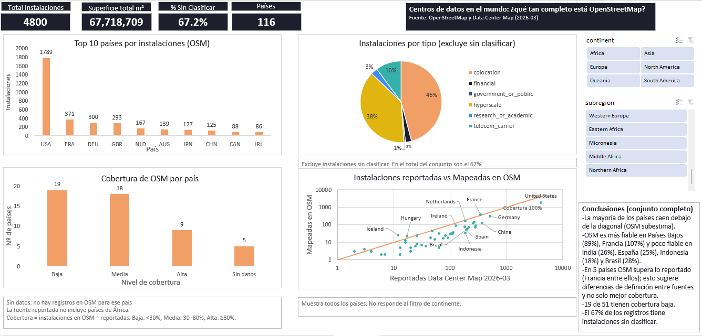

# Cobertura de OpenStreetMap en centros de datos

Análisis en Excel (Power Query, modelo de datos, tablas dinámicas y segmentadores) que compara los centros de datos mapeados en OpenStreetMap (OSM) con los totales reportados por país en Data Center Map.

## Pregunta

¿Qué tan completo es OpenStreetMap como fuente de centros de datos y en qué países se puede confiar?

## Hallazgos

- La mayoría de los países cae por debajo de la diagonal: OSM subestima lo reportado.
- OSM es más fiable en Países Bajos (89%) y Francia (107%), y poco fiable en India (26%), España (25%), Indonesia (18%) y Brasil (28%).
- En 5 países OSM supera lo reportado (Francia entre ellos), lo que sugiere diferencias de definición entre fuentes y no solo mejor cobertura.
- De los 51 países reportados, 19 tienen cobertura baja, 18 media y 9 alta; 5 no tienen registros en OSM.
- El 67% de las instalaciones de OSM no tiene tipo asignado.

## Contenido

| Archivo | Descripción |
|---|---|
| `ProyectoDataCenter.xlsm` | Libro de Excel con el modelo de datos, el dashboard y la hoja LEEME |
| `dashboard.png` / `dashboard.pdf` | Captura y PDF del dashboard sin filtros |
| `data_centers.csv` | Instalaciones de OSM (4,802 registros) |
| `country_summary.csv` | Resumen por país de OSM (116 países) |

El libro contiene una macro que actualiza los datos. Al abrirlo, habilita el contenido.

## Cómo se calcula la cobertura

Cobertura = instalaciones en OSM ÷ instalaciones reportadas (Data Center Map, corte 2026-03).

| Nivel | Rango |
|---|---|
| Baja | menos de 30% |
| Media | de 30% a menos de 80% |
| Alta | 80% o más |
| Sin datos | país reportado sin registros en OSM |

## Decisiones de limpieza

- Archivos importados en UTF-8.
- 2 registros sin país excluidos (4,802 pasan a 4,800).
- Se usó solo el corte 2026-03 de los totales reportados, que tenía 20 países duplicados.
- Mauricio reclasificado de "Seven seas" a África.
- Región asignada a mano a 5 países reportados sin registros en OSM (Chipre, Estonia, Malta, Bosnia y Herzegovina, Mónaco).

El detalle completo está en la hoja `LEEME` del libro.

## Limitaciones

- La fuente reportada no incluye países de África, así que no hay cobertura para ese continente.
- Los totales reportados no son una verdad absoluta: tienen su propia metodología y fecha de corte.
- La cobertura se calcula solo para los 51 países reportados; OSM tiene registros en 116.
- La dispersión muestra todos los países y no responde a los segmentadores.

## Fuentes

- © colaboradores de OpenStreetMap.
- Data Center Map, publicado por Visual Capitalist (totales reportados, incluidos en el libro de Excel).

## Herramientas

Excel: Power Query, Power Pivot, DAX, tablas dinámicas y segmentadores.
